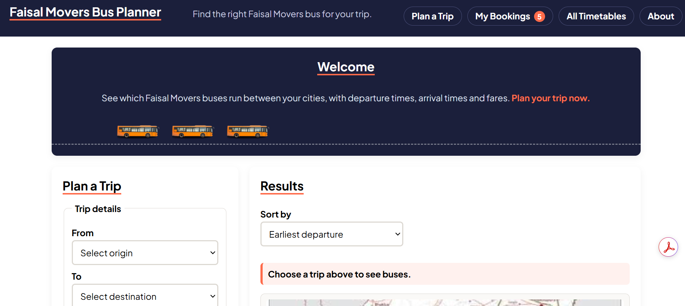
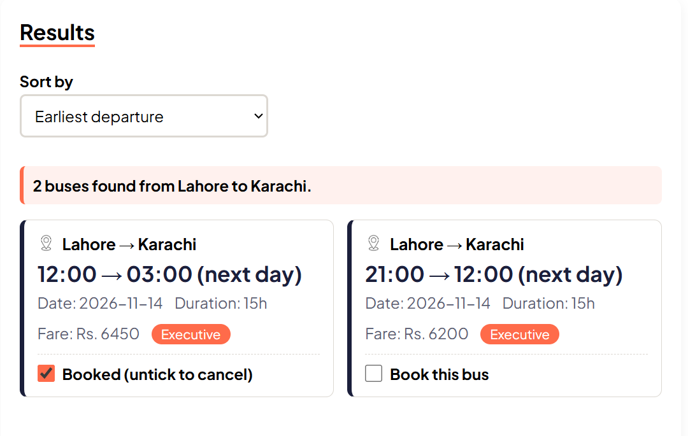
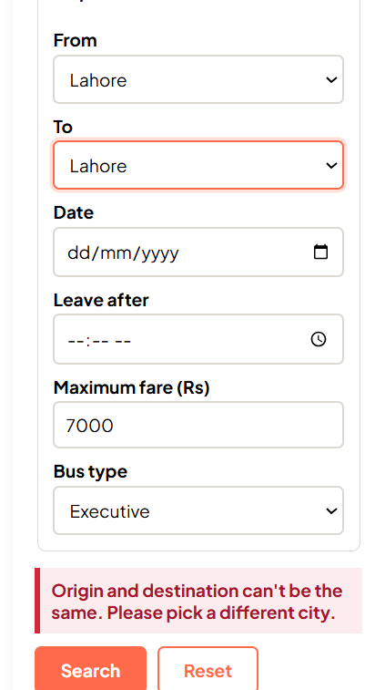
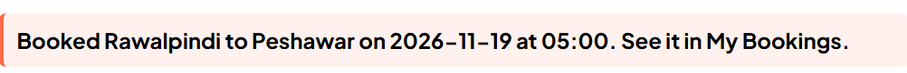
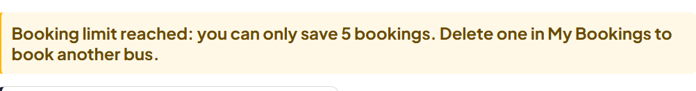
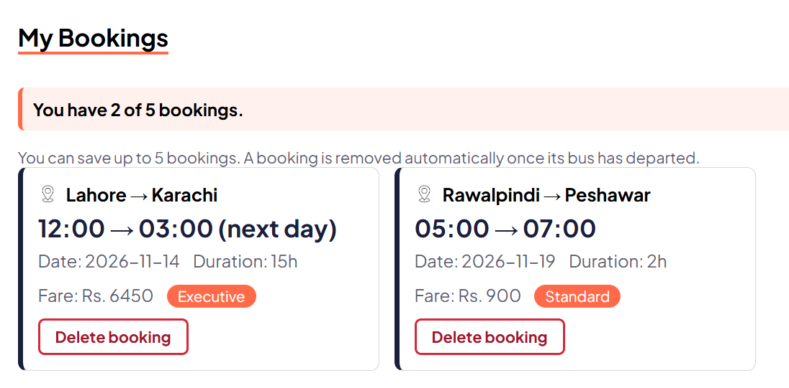
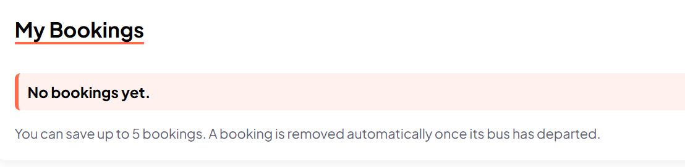
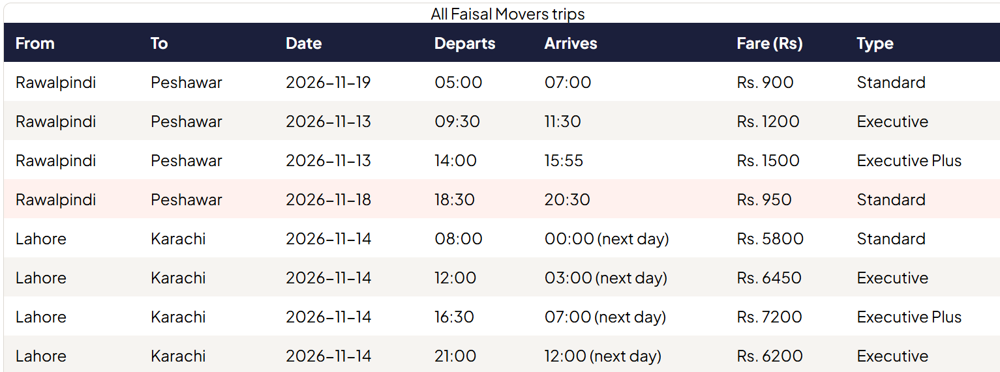

# Faisal Movers Bus Planner

A client-side inter-city bus schedule planner with trip search, sorting, a live timetable and saved bookings.

**Course:** Web Engineering (5th Semester)
**Author:** Armaghan Mahmood Shams
**Tech:** HTML5, CSS3, Vanilla JavaScript (ES6+),

> Independent student project for educational purposes. It is not affiliated with Faisal Movers. All routes, times and fares are sample data.

For the problem statement, wireframes, WDLC stages and the client/server analysis, see [DESIGN_NOTE.md](DESIGN_NOTE.md).

---


### Home

| Desktop (1000px+) | Mobile (under 600px) |
| :---: | :---: |
|  |  |
| *Capture: header, welcome banner with moving buses, planner form and route map.* | *Capture: stacked layout with full-width buttons and the contained bus animation.* |

### Searching

| Search results | Validation error |
| :---: | :---: |
|  |  |
| *Capture: a search such as Rawalpindi to Lahore, showing cards with the "Book this bus" checkbox and the map hidden.* | *Capture: the red message shown when origin and destination are the same.* |

### Bookings

| Booking confirmed | Booking limit warning |
| :---: | :---: |
|  |  |
| *Capture: a ticked checkbox and the peach confirmation message.* | *Capture: the amber warning after trying to book a sixth bus.* |

| My Bookings (with items) | My Bookings (empty) |
| :---: | :---: |
|  |  |
| *Capture: several booking cards, each with a Delete booking button, and the "x of 5 bookings" summary.* | *Capture: the "You don't have any bookings" message.* |

### Timetable



*Capture: the full timetable, ideally with the city filter in use.*

---

## Features

**Trip search**
- Choose origin and destination, then optionally narrow by date, earliest departure time, maximum fare and bus type (Standard, Executive, Executive Plus).
- Sort results by earliest departure, lowest fare or shortest trip.
- Validation with clear messages for a missing city, identical origin and destination, or a negative fare.
- Results update live when sort, fare or bus type changes after a first search.

**Bookings**
- Tick **Book this bus** on any result card to save it.
- Up to **5 bookings** can be saved. Trying to add a sixth shows a warning and leaves the checkbox unticked.
- The **My Bookings** section lists saved trips, shows how many of the 5 are used, and lets you delete any booking.
- With no bookings, it shows a "You don't have any bookings" message.
- A count badge on the **My Bookings** navigation link shows how many trips are saved.
- Bookings persist across page reloads using `localStorage`.

**Interface**
- Route map image shows by default, hides when results appear and returns on reset.
- Moving three-bus animation in the welcome banner.
- Responsive layout: two-column grid on laptops, stacked single column on phones, horizontally scrollable timetable.
- Live timetable filter by city.

---

## How Bookings Handle Dynamic Dates


- A booking saves a **snapshot of the whole trip**, including its date, not just the bus ID. A booking keeps showing the date it was made for.
- A booking is identified by **bus ID + date**, so FM-02 today and FM-02 tomorrow are separate bookings.
- Bookings whose departure time has passed are **removed automatically** on page load and when the tab is revisited.
- Buses that have already left today show a disabled "Already departed" checkbox.

---

## Project Structure

```
bus-planner/
├── index.html          Page structure (header, planner, results, bookings, timetable, footer)
├── style.css           All styling, including responsive media queries
├── script.js           Sample data, search, sorting, rendering and bookings logic
├── img/                Media
├── screenshots/        Images used in this README
├── README.md
└── DESIGN_NOTE.md
```

## Where Things Live in `script.js`

| Area | Main functions |
| :--- | :--- |
| Sample data | `getDynamicDate`, the `data` array (dataset at the top of the file) |
| Search | `validate`, `runSearch`, `sortResults`, `renderResults` |
| Timetable | `renderTimetableTable` and the filter listener in `init` |
| Bookings | `readBookings`, `writeBookings`, `handleBookingChange`, `deleteBooking`, `renderBookings`, `refreshBookingsUI` |
| Startup | `init` |

To change routes, fares or times, edit the `data` array at the top of `script.js`.

---

## How to Run

1. Download or clone the project folder.
2. Open `index.html` in any modern browser (Chrome, Firefox, Edge or Safari).
3. No build tools, Node.js or packages are needed.

Bookings are stored in the browser you use, so they will not appear in a different browser or on another device. Clearing site data removes them.

## Deployment

The project is static (HTML, CSS, JS and images), so it can be hosted on GitHub Pages, a university web server or Apache/Nginx without any changes.
